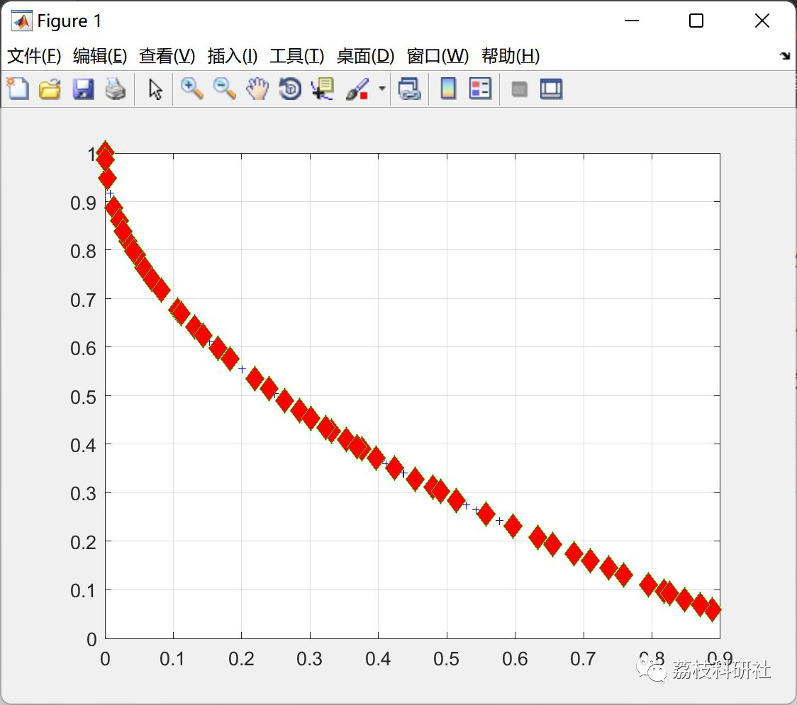
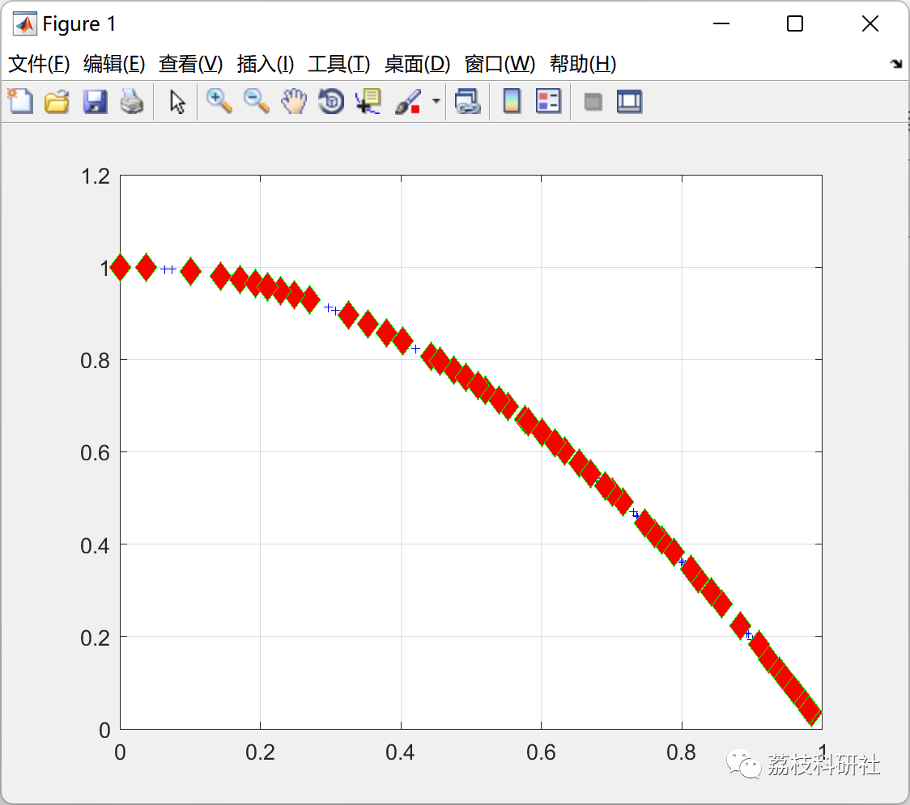

# Multi-objective Ephemeropter Optimization Algorithm (Matlab Code Implementation)

💥💥💥💞💞💞💞 Welcome to this blog❤️❤️❤️💥💥💥
🏆 Bloggers' Advantage: 🌞🌞🌞 The content of the blog strives to be rigorous in thought and clear in logic, for the convenience of readers.
⛳️ Mantra: The journey of a hundred miles is half done in the last ninety.
Litchi Research Society
Code Collection: Power System, Intelligent Algorithms and Applications, Neural Network Prediction, Path Planning, Optimized Scheduling, Workshop Scheduling, Image Processing, Signal Processing...
🎁Column Directory Link:
🌈🌈🌈🌟🌟🌟Electrical Code Intelligent Algorithm and Its Application Path Planning Neural Network Predictive Optimization Scheduling Image Processing Workshop Scheduling Signal Processing Romantic Her My Philosophical Thoughts Math Modeling Complete Code Matters
💥1 Overview
​  
The Ephemeris Algorithm (MA) is a new method proposed by Konstantinos Zervoudakis in 2020 to address optimization problems. Inspired by the flight behavior and mating process of the ephemeral fly, this algorithm combines the main advantages of both group intelligence and evolutionary algorithms. To evaluate the performance of the proposed algorithm, 38 mathematical benchmark functions were used, including 13 CEC2017 test functions, and the results were compared with those of seven state-of-the-art well-known metaheuristic optimization methods. The performance of MA was also evaluated through convergence behavior in multi-objective optimization and using real-world discrete flow shop scheduling problems. The comparison results demonstrated the superiority of the proposed method in terms of convergence speed and efficiency. The wedding dance and random flight processes enhanced the balance between exploration and exploitation of attributes, helping the algorithm escape local optima.
📚2 Running Results
🎉3 References
[1] Zervoudakis, K., & Tsafarakis, S. (2020). A mayfly optimization algorithm. Computers & Industrial Engineering, 145, 106559. https://doi.org/10.1016/j.cie.2020.106559  
🌈4 Matlab code implementation

## Images

<!-- PAYMENT_BLOCK -->

## Get this dataset

- Payment link (Stripe): [Buy now](https://buy.stripe.com/3cs8yP7sY87d0vu9AB)
- Payment QR code: 

<!-- /PAYMENT_BLOCK -->
